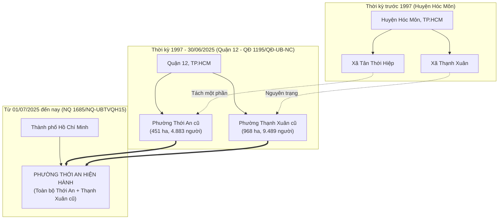

# ADR-002: BATCH B – GEO-TEMPORAL & ADMINISTRATIVE CROSSWALK
## ĐỐI CHIẾU KHÔNG GIAN – THỜI GIAN VÀ ĐỊA GIỚI HÀNH CHÍNH (SÀI GÒN / TP.HCM / THỚI AN)

**Dự án:** Hệ thống Không gian Văn hóa Hồ Chí Minh – Trường THCS Nguyễn Trung Trực  
**Phạm vi:** Đối chiếu địa danh lịch sử, địa giới hành chính và quy tắc định danh chuẩn cho hệ thống RAG  
**Thời điểm lập:** 2026-11-14T17:00:00Z  
**Phương châm:** HISTORICAL ACCURACY – OFFICIAL SOURCES – GEOGRAPHICAL PRECISION  

---

## I. NGUYÊN TẮC BẮT BUỘC VỀ ĐỊA DANH VÀ ĐỊA GIỚI (MỤC II MASTER PROMPT)

### 1. Địa danh hiện hành chuẩn:
- Tên gọi chính thức hiện hành: **Phường Thới An, Thành phố Hồ Chí Minh.**
- Tuyệt đối không dùng tên gọi *"Phường Thới An, Quận 12"* như một đơn vị hành chính đương thời sau ngày 01/07/2025.

### 2. Địa danh lịch sử trước ngày 01/07/2025:
- Khi trích dẫn, tra cứu các sự kiện, văn bản ban hành trước ngày 01/07/2025, **phải bảo toàn tên gọi gốc lịch sử**:
  - *Phường Thới An, Quận 12, Thành phố Hồ Chí Minh* (Thời kỳ 1997 - 30/06/2025).
  - *Phường Thạnh Xuân, Quận 12, Thành phố Hồ Chí Minh* (Thời kỳ 1997 - 30/06/2025).
  - *Xã Tân Thới Hiệp, Huyện Hóc Môn, Thành phố Hồ Chí Minh* (Thời kỳ trước tháng 4/1997).
  - *Xã Thạnh Xuân, Huyện Hóc Môn, Thành phố Hồ Chí Minh* (Thời kỳ trước tháng 4/1997).
- Không tự ý thay thế hồi tố các tên gọi lịch sử trong văn bản cũ bằng địa danh hiện tại.

### 3. Căn cứ pháp lý hiện hành cao nhất:
- **Nghị quyết số 1685/NQ-UBTVQH15** ngày 16/06/2025 của Ủy ban Thường vụ Quốc hội.
- **Khoản 35 Điều 1:** Sắp xếp toàn bộ diện tích tự nhiên và quy mô dân số của phường Thạnh Xuân và phường Thới An cũ thành đơn vị hành chính mới có tên là **Phường Thới An, Thành phố Hồ Chí Minh**.
- **Ngày chính thức vận hành:** Ngày 01/07/2025.
- **Phạm vi kế thừa:** Phường Thới An mới chỉ kế thừa trọn vẹn diện tích và dân số từ hai phường cũ (Thới An và Thạnh Xuân); **tuyệt đối không được hiểu rằng toàn bộ địa bàn Quận 12 cũ thuộc về phường Thới An**.

---

## II. BẢNG ĐỐI CHIẾU ĐƠN VỊ HÀNH CHÍNH QUA 5 THỜI KỲ LỊCH SỬ

| Thời kỳ lịch sử | Phạm vi thời gian | Đơn vị hành chính cấp tỉnh / thành phố | Đơn vị hành chính cấp quận / huyện | Đơn vị hành chính cấp xã / phường liên quan Thới An | Căn cứ pháp lý / Nguồn xác minh |
|:---|:---|:---|:---|:---|:---|
| **Thời kỳ 1: Khởi nguyên – 1698** | Khởi nguyên đến thế kỷ XVII | Vùng đất phương Nam chưa định danh hành chính Đại Việt | Lưu vực sông Đồng Nai - Bến Nghé | Địa bàn tụ cư tự nhiên của các bộ tộc cổ | *Gia Định thành thông chí* & *Lịch sử Sài Gòn - TP.HCM* Tập 1 |
| **Thời kỳ 2: Chúa Nguyễn – Nhà Nguyễn** | 1698 – 1858 | Phủ Gia Định (1698) $
ightarrow$ Trấn Phiên An $
ightarrow$ Gia Định Thành $
ightarrow$ Tỉnh Gia Định (1832) | Huyện Tân Bình $
ightarrow$ Huyện Bình Long | Các thôn/làng Thới An, Thạnh Xuân, Quới Xuân thuộc tổng Bình Thạnh Hạ | *Gia Định thành thông chí* của Trịnh Hoài Đức |
| **Thời kỳ 3: Thời kỳ Pháp thuộc – Kháng chiến** | 1859 – 1975 | Tỉnh Gia Định (thời Pháp thuộc); Tỉnh Gia Định / Khu Sài Gòn - Gia Định (thời kháng chiến) | Quận Hóc Môn | Làng/Xã Thới An, Thạnh Xuân; Căn cứ Chiến khu An Phú Đông | *Lịch sử Sài Gòn - TP.HCM* Tập 3, Tập 4 & Lịch sử Đảng bộ địa phương |
| **Thời kỳ 4A: Sau thống nhất đến trước 1997** | 30/04/1975 – 31/03/1997 | Thành phố Hồ Chí Minh (từ 02/07/1976) | Huyện Hóc Môn | Xã Tân Thới Hiệp và Xã Thạnh Xuân | Nghị quyết Quốc hội khóa VI (1976) |
| **Thời kỳ 4B: Thời kỳ Quận 12** | 01/04/1997 – 30/06/2025 | Thành phố Hồ Chí Minh | **Quận 12** (Thành lập theo Nghị định 03-CP) | **Phường Thới An** (451 ha) và **Phường Thạnh Xuân** (968 ha) tách biệt | Quyết định số 1195/QĐ-UB-NC ngày 18/03/1997 của UBND TP.HCM |
| **Thời kỳ 5: Thời kỳ Sắp xếp ĐVHC Hiện hành** | **01/07/2025 – Nay** | **Thành phố Hồ Chí Minh** (Chính quyền đô thị 2 cấp) | Không còn cấp quận (Trực thuộc Thành phố) | **Phường Thới An** (Hợp nhất trọn vẹn từ 2 phường Thới An và Thạnh Xuân cũ) | **Nghị quyết số 1685/NQ-UBTVQH15** ngày 16/06/2025 của UBTVQH |

---

## III. BẢN ĐỒ QUAN HỆ KHÔNG GIAN VÀ ĐỊA GIỚI (MERMAID)

---

## IV. QUY TẮC XỬ LÝ NGỮ NGHĨA CHO RAG (RAG DISAMBIGUATION RULES)

1. **Quy tắc câu hỏi về địa chỉ hiện tại:** Khi người dùng hỏi *"Trường THCS Nguyễn Trung Trực hiện nay ở đâu?"*, câu trả lời chuẩn xác là:  
   👉 **Phường Thới An, Thành phố Hồ Chí Minh.**
2. **Quy tắc câu hỏi về lịch sử thành lập trường (2014):** Khi người dùng hỏi *"Trường được thành lập năm nào, do ai ký quyết định?"*, câu trả lời phải dẫn đúng lịch sử:  
   👉 Ngày 31/07/2014 theo Quyết định số 155/QĐ-UBND của **UBND Quận 12**, tại địa bàn *phường Thới An, Quận 12*.
3. **Quy tắc phân biệt phạm vi phường Thới An mới:** Không được nhầm lẫn phường Thới An với toàn bộ Quận 12 cũ. Khi được hỏi về các phường khác (như Hiệp Thành, Tân Chánh Hiệp, Đông Hưng Thuận...), RAG phải khẳng định đây là các địa bàn độc lập, không sáp nhập vào Thới An.
4. **Quy tắc không suy diễn địa danh lịch sử Anh hùng Nguyễn Trung Trực:** Khẳng định rõ: Trường THCS mang tên Anh hùng Nguyễn Trung Trực là sự tri ân tiền nhân yêu nước; ông không sinh ra và không chỉ huy chiến đấu trực tiếp tại Thới An (chiến công của ông diễn ra tại sông Nhật Tảo - Long An và đồn Rạch Giá - Kiên Giang).
